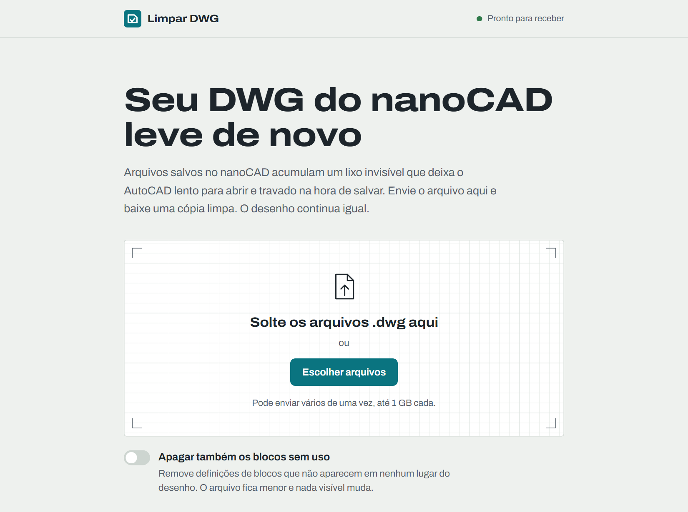

# Limpar DWG

Remove o lixo invisível que o **nanoCAD** deixa nos arquivos DWG e que deixa o AutoCAD lento para
abrir e travado ao salvar. A pessoa arrasta o `.dwg` para a página, acompanha a limpeza e baixa uma
cópia `_LIMPO.dwg`.

Tudo roda num único container Docker. **Não precisa de AutoCAD, ODA nem nenhum programa da Autodesk.**
O motor de limpeza lê e grava DWG diretamente, em Rust.

**Em resumo:** uma planta de 8 MB que o AutoCAD levava ~30 minutos para limpar fica pronta em poucos segundos
e 70% menor, com o mesmo desenho.

<p align="center">
  
</p>

<p align="center">
  
  
</p>

## Como usar

1. Abra a página e arraste um ou mais arquivos `.dwg` para a área indicada (ou clique em
   **Escolher arquivos**).
2. Se quiser, ligue **Apagar também os blocos sem uso** para um arquivo ainda menor.
3. Acompanhe o progresso de cada arquivo e clique em **Baixar cópia limpa** quando terminar.
4. Abra a cópia `_LIMPO.dwg` no AutoCAD e confira antes de substituir o original.

A página funciona no modo claro e escuro e lembra os arquivos enviados, então dá para fechar a aba e
voltar depois para baixar.

## O problema

Ao salvar, o nanoCAD acumula tabelas de ordem de desenho (`SORTENTSTABLE`) duplicadas nos dicionários
dos blocos, com nomes `*A1`, `*A2`… Uma planta comum chega a centenas de milhares delas, e uma grande
passa de 1,5 milhão. O desenho não muda em nada, mas o AutoCAD passa a levar minutos para abrir e
salvar, ou trava.

| | Limpeza pelo AutoCAD (script LISP) | Limpar DWG |
|---|---|---|
| Planta FL03 (8 MB, 385 mil tabelas) | ~30 min | **4 s** |
| Planta Jabaquara (88 MB, 1,6 milhão de tabelas) | inviável | **40 a 60 s** |

O AutoCAD apaga as tabelas uma a uma, passando por desfazer, notificações e validação a cada objeto.
O motor carrega o arquivo na memória, descarta tudo numa passada e grava um DWG novo.

## O que a limpeza faz

1. Remove as tabelas de ordem de desenho duplicadas (`*A…`) de todos os blocos e espaços. A tabela
   legítima, `ACAD_SORTENTS`, é mantida.
2. Apaga os blocos `Clipboard*` sem uso, restos de copiar e colar. Com a opção
   **Apagar também os blocos sem uso**, apaga todos os blocos nomeados que não aparecem no desenho.
3. Apaga hachuras sem nenhum contorno, como o `AUDIT` do AutoCAD faria.
4. Remove os vínculos de tabela com Excel (`DATALINK`), porque a biblioteca de DWG ainda não os grava
   corretamente. As tabelas continuam no desenho com o conteúdo atual, só deixam de atualizar pela
   planilha. A página avisa quando isso acontece.
5. Copia byte a byte, sem alteração, qualquer objeto que o motor não consiga interpretar, como as
   superfícies 3D da planta do Jabaquara.

O arquivo original nunca é alterado e a cópia limpa sai na **mesma versão de DWG** do arquivo enviado.

## Subir com Docker

```bash
git clone https://github.com/mfelipedias/limpar-dwg.git
cd limpar-dwg
cp .env.example .env        # ajuste; defina WEB_PASSWORD se o servidor for acessível de fora
docker compose up -d --build
```

Acesse `http://SERVIDOR:8080` (ou a porta definida em `PORT`). O primeiro build compila o motor em Rust e leva alguns minutos.

Os arquivos ficam no volume `dados` (`/data` no container) e são apagados automaticamente depois de
`RETENTION_HOURS`.

### Configuração (`.env`)

| Variável | Padrão | Para quê |
|---|---|---|
| `PORT` | `8080` | Porta publicada no servidor |
| `WEB_USER` / `WEB_PASSWORD` | vazio | Login do site (HTTP Basic). Com a senha vazia, o site fica aberto |
| `MAX_UPLOAD_MB` | `1024` | Tamanho máximo de cada arquivo |
| `RETENTION_HOURS` | `48` | Tempo até apagar os arquivos do servidor |
| `CONCURRENCY` | `1` | Quantos arquivos são limpos ao mesmo tempo |
| `JOB_TIMEOUT_MINUTES` | `30` | Tempo máximo de uma limpeza |

### Memória

A limpeza carrega o desenho inteiro na memória. A planta do Jabaquara (88 MB, 1,6 milhão de tabelas)
chega a uns **6,5 GB** de pico. Arquivos comuns usam bem menos. Se faltar memória, o trabalho falha com
um aviso na página. Em servidores com pouca RAM, mantenha `CONCURRENCY=1` e, se quiser, limite o
container com `mem_limit` no `docker-compose.yml`.

### Atrás de um proxy reverso

Libere uploads grandes e respostas demoradas. No nginx:

```nginx
client_max_body_size 1100m;
proxy_request_buffering off;
proxy_read_timeout 600s;
```

## Como funciona

```
navegador ──upload──► servidor (FastAPI) ──fila──► nanoclean (Rust)
          ◄─progresso─                    ◄─JSON──  lê o DWG, limpa, grava o DWG
```

```
.
├── Dockerfile            build em duas etapas: compila o motor e monta a imagem Python
├── docker-compose.yml
├── .env.example
├── engine/               motor nanoclean (Rust)
│   ├── src/main.rs
│   └── vendor/acadrust/  biblioteca de DWG, com duas correções (veja MODIFICACOES.md)
├── server/               FastAPI: upload, fila, progresso, download
│   ├── app.py
│   └── static/           página (HTML, CSS e JS puros, sem build)
└── docs/                 imagens deste README
```

- **Servidor** (`server/app.py`): recebe o upload por streaming, valida que é um DWG, coloca na fila e
  executa o motor como subprocesso, lendo o progresso que ele imprime em JSON. Os trabalhos ficam
  em `/data/jobs/<id>/` e sobrevivem a um reinício do container.
- **Página** (`server/static/`): arrastar e soltar, envio de vários arquivos com barra de progresso,
  acompanhamento por etapa e download. Lembra os arquivos enviados pelo navegador, então dá para
  fechar e voltar.
- **Motor** (`engine/`): o `nanoclean`, escrito sobre a [acadrust](https://github.com/hakanaktt/acadrust)
  0.6.8, biblioteca livre que lê e grava DWG nativamente. A cópia em `engine/vendor/acadrust` tem duas
  correções nossas:
  - vértices de polilinha 2D gravados com o linetype da polilinha dona (sem isso, o `AUDIT` do AutoCAD
    acusava erros);
  - entidades que a biblioteca não consegue decodificar são preservadas byte a byte em vez de
    descartadas.

### API

| Método | Caminho | Descrição |
|---|---|---|
| `POST` | `/api/jobs?filename=<nome>&purge=<true\|false>` | Envia o DWG no corpo da requisição (`application/octet-stream`) |
| `GET` | `/api/jobs?ids=<id>,<id>` | Situação de vários trabalhos |
| `GET` | `/api/jobs/<id>` | Situação, progresso, resultado e log de um trabalho |
| `GET` | `/api/jobs/<id>/download` | Baixa o DWG limpo |
| `DELETE` | `/api/jobs/<id>` | Cancela um trabalho em andamento ou apaga um concluído |
| `GET` | `/api/status` | Fila, limites e se o motor está disponível |
| `GET` | `/healthz` | Verificação de saúde (sem login) |

## Usar o motor sem o site

Precisa do Rust 1.85 ou mais recente (edição 2024).

```bash
cd engine
cargo build --release
./target/release/nanoclean entrada.dwg saida_LIMPO.dwg [--purge] [--keep-datalinks]
```

- `--purge`: apaga todos os blocos nomeados sem uso, não só os `Clipboard*`.
- `--keep-datalinks`: mantém os vínculos com Excel. **O AutoCAD pode recusar o arquivo gerado.**

O progresso sai no stdout, uma linha JSON por etapa.

## Validação

Os resultados foram abertos no AutoCAD 2026 e comparados contando entidades, blocos, layers e a soma
das coordenadas, além de um `AUDIT`:

| | Original limpo pelo AutoCAD | Limpar DWG |
|---|---|---|
| FL03: tabelas `*A` removidas | 385.152 | 385.152 |
| FL03: entidades / blocos / entidades em blocos / layers | 6.509 / 221 / 11.597 / 180 | idênticos |
| FL03: soma de controle das coordenadas | 62.422.313,8832 | idêntica |
| FL03: erros no `AUDIT` | 0 | 0 |
| Jabaquara: entidades / superfícies 3D / layers | 19.515 / 22 / 227 (original) | idênticos |
| Jabaquara: erros no `AUDIT` | — | 0 |

Além dos `Clipboard*`, somem os blocos anônimos de cota (`*D…`) que pertenciam a cotas dentro deles,
como num `PURGE` do AutoCAD.

## Limitações

- **Vínculos com Excel são removidos.** A acadrust ainda não grava `DATALINK` de forma que o AutoCAD
  aceite.
- **Sem conversão de versão.** A acadrust não consegue regravar em outra versão de DWG quando há objetos
  customizados (AutoCAD Mechanical, AEC…), então a cópia sai na versão original.
- **Uso de memória alto** em arquivos muito grandes (veja [Memória](#memória)).
- A acadrust é uma biblioteca nova. Ela passou nas plantas testadas, mas confira os primeiros resultados
  no AutoCAD antes de substituir os originais.

## Licenças de terceiros

- [acadrust](https://github.com/hakanaktt/acadrust): MPL-2.0. Os arquivos modificados estão listados em
  `engine/vendor/acadrust/MODIFICACOES.md` e continuam sob a MPL-2.0.
- Fonte [Archivo](https://fonts.google.com/specimen/Archivo) (Omnibus-Type): SIL Open Font License 1.1,
  embutida em `server/static/fonts/`.
